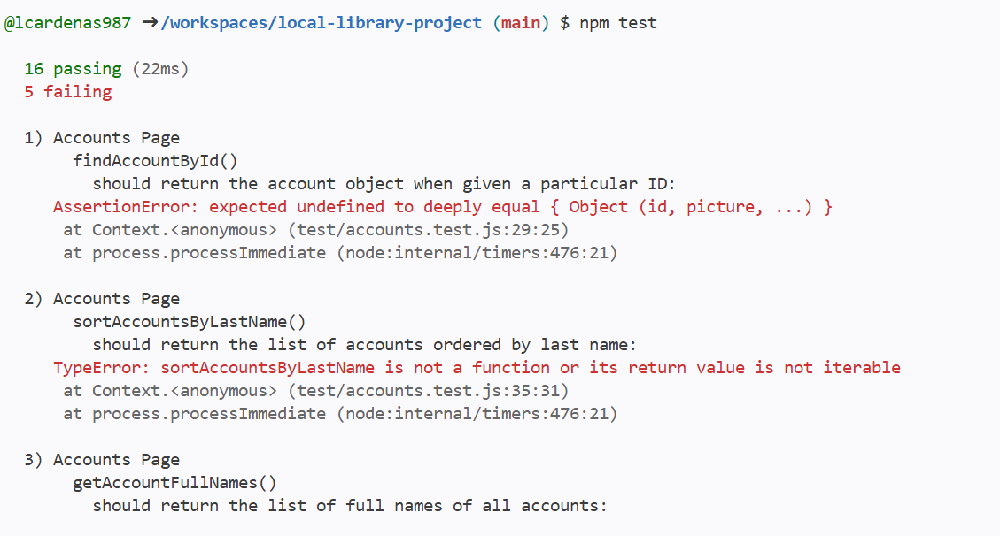
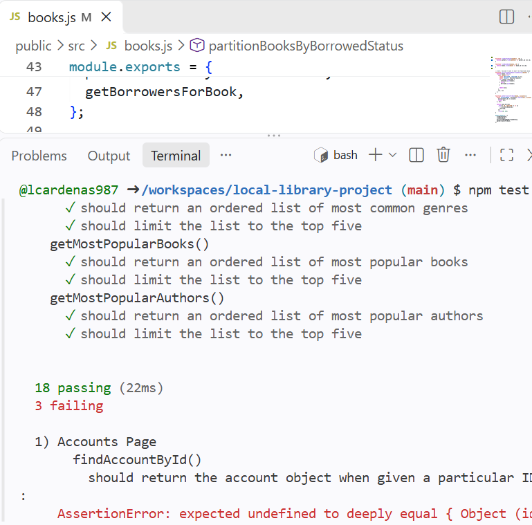
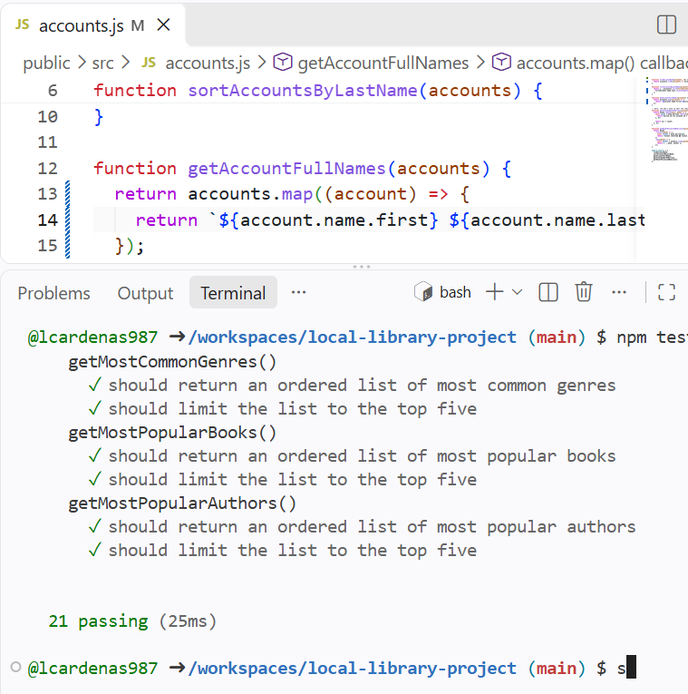
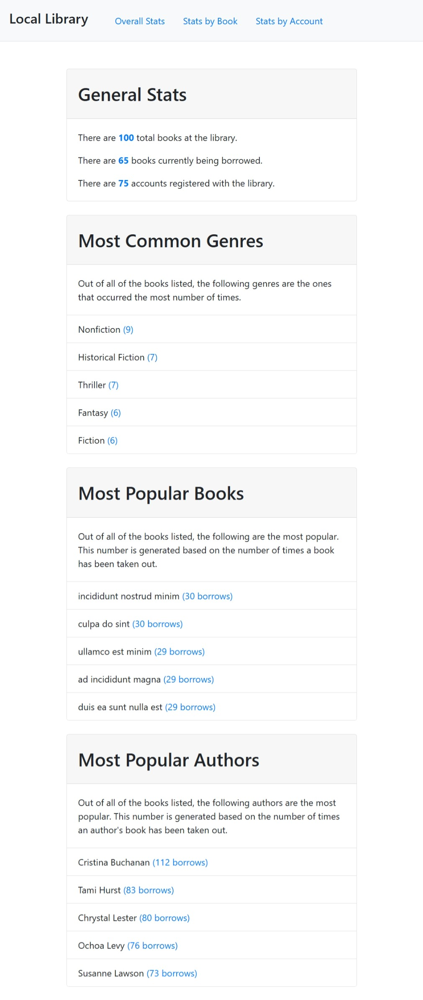
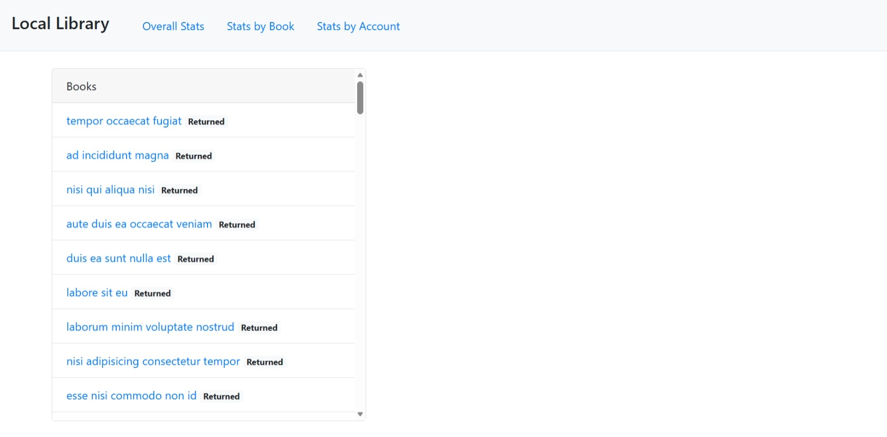
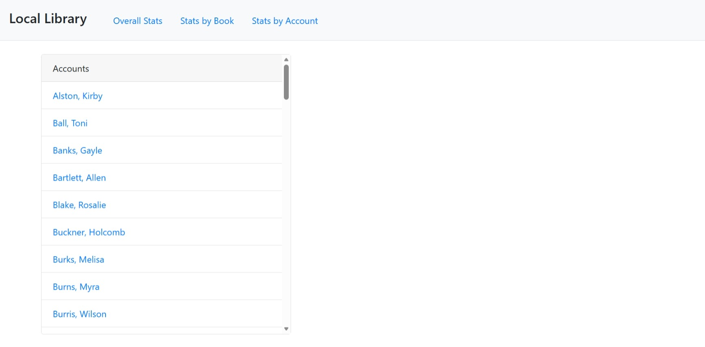
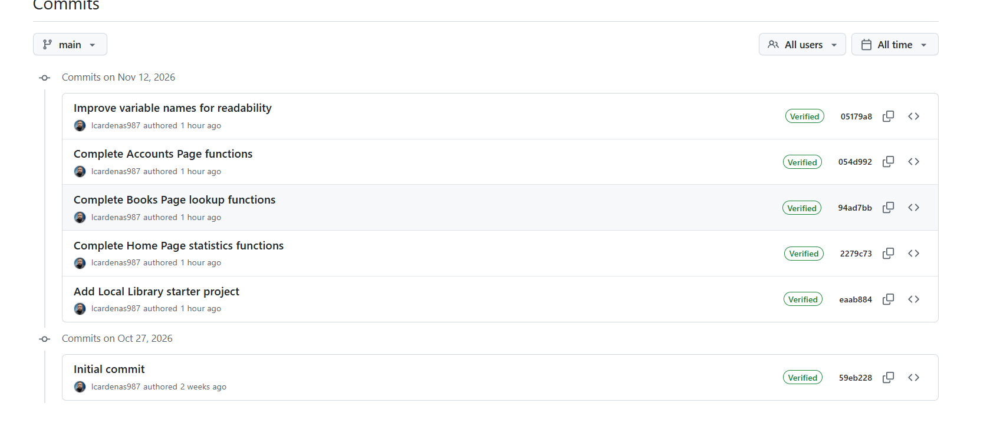

# Local Library Project

## Project Description

The Local Library project is a JavaScript application designed to help manage a neighborhood library. The website displays information about books, authors, and registered accounts.

My responsibility was to complete the JavaScript functions that calculate library statistics, organize book information, and retrieve account details. The HTML, CSS, and original datasets were already provided.

## Project Plan

The project uses three main datasets:

- **Books:** Contains book titles, genres, authors, and borrowing records.
- **Authors:** Contains author names and identification numbers.
- **Accounts:** Contains registered library members and their information.

I planned to complete the functions in three JavaScript files.

### Home Page — home.js

The Home Page functions calculate the total number of books, total accounts, and number of books currently borrowed.

The existing functions also display the most common genres, most popular books, and most popular authors.

### Books Page — books.js

The Books Page functions find authors and books by their IDs, separate books based on borrowing status, and retrieve borrower information.

### Accounts Page — accounts.js

The Accounts Page functions find accounts by ID, sort accounts alphabetically by last name, generate full names, count borrowing records, and identify books currently possessed by an account.

## Implementation Plan

1. Download the Local Library starter project.
2. Open the project using GitHub Codespaces.
3. Install Node.js 18 and project dependencies.
4. Run `npm test` to identify incomplete functions.
5. Complete the Home Page functions.
6. Complete the Books Page lookup functions.
7. Complete the Accounts Page functions.
8. Run automated tests after each group of changes.
9. Review variable names and coding requirements.
10. Test the website using `npm start`.
11. Document the project and development process in GitHub.

## Navigation Structure

The Local Library dashboard includes three main pages:

- **Overall Stats:** Displays library statistics, popular books, authors, and genres.
- **Stats by Book:** Displays book information and borrowing history.
- **Stats by Account:** Displays registered library accounts and their borrowing information.

This navigation structure separates the main library information into categories, making the dashboard easier to use.

## Algorithms and JavaScript Features

### Array Methods

I used JavaScript array methods to complete the required functions.

- `find()` retrieves an account, author, or book matching a specific ID.
- `filter()` identifies books that meet borrowing conditions.
- `map()` creates lists of account names.
- `sort()` arranges accounts alphabetically.
- `some()` checks whether a book has an unreturned borrowing record.

### Arrow Functions

Arrow functions were used with array methods to make the code more concise.

### Spread Operator

The spread operator was used to create a copy of the accounts array before sorting it. This prevents the original array from being modified.

### Template Literals

Template literals were used to combine account first and last names into full names.

## Design Decisions and Trade-offs

I used JavaScript's built-in array methods rather than writing manual loops for every function. These methods made the code easier to organize and understand.

I chose descriptive variable names to improve readability and meet the project rubric.

One trade-off was using the spread operator before sorting accounts. This creates an additional array, but it protects the original data from being changed.

I kept the original HTML and CSS because the assessment focused on JavaScript algorithms rather than website design.

## Challenges, Debugging, and Troubleshooting

### Project Setup

I needed to organize the downloaded project files into the correct folder structure in GitHub Codespaces.

I also installed Node.js 18 because the assessment specified that version.

### Initial Test Failures

When I first ran `npm test`, the project had 11 passing tests and 10 failing tests.

I used the test output to identify which functions still needed to be completed.

### Home Page Functions

I completed the functions for counting books, accounts, and borrowed books.

After testing these functions, the project improved to 16 passing tests and 5 failing tests.

### Books Page Functions

I completed the author and book lookup functions using `find()`.

After testing, the project reached 18 passing tests and 3 failing tests.

### Accounts Page Functions

I completed the functions for finding accounts, sorting accounts, and generating full names.

After these changes, all 21 automated tests passed.

### Variable Names

I reviewed the code for single-letter variable names and updated an existing calculation in `home.js` to use more descriptive names.

I ran the automated tests again to confirm the changes did not affect the results.

## Test Results

The final automated test results were:

**21 passing — 0 failing**

All automated tests passed after completing the JavaScript functions.

### Home Page Test Results

### Books Page Test Results

### Final Test Results

## Website Screenshots

### Overall Statistics Dashboard

### Stats by Book

### Stats by Account

## AI Tools Disclosure

I used ChatGPT to help with some troubleshooting and organized my README documentation.

I used ChatGPT because it provided examples and explanations that helped me work through the project requirements. 

GitHub Codespaces was used as my development environment, and GitHub was used for version control.

## Git Commit History

I created Git commits to document the main development stages.

### Git Commit History Screenshot

[View Complete GitHub Commit History](https://github.com/lcardenas987/local-library-project/commits/main/)

**Development environment note:** Screenshots were captured using GitHub Codespaces and the browser rather than Replit.

## Project Process Summary

I started this project by setting up the Local Library starter files in GitHub Codespaces and installing the required dependencies using Node.js 18. I ran the automated tests to identify which JavaScript functions needed to be completed. The initial test results showed 11 passing tests and 10 failing tests.

I completed the Home Page functions first, followed by the Books Page and Accounts Page functions. I used JavaScript array methods such as `find()`, `filter()`, `map()`, and `sort()` to work with the library datasets. After completing the functions, all 21 automated tests passed.

I also reviewed variable names for readability, tested the library dashboard in my browser, and created Git commits to document my progress.  control.

## Project Links

**GitHub Repository:**

https://github.com/lcardenas987/local-library-project

## Conclusion

This project gave me experience working with JavaScript algorithms and large datasets. I learned how to use native array methods to retrieve, organize, and calculate information while using automated tests to verify my work.